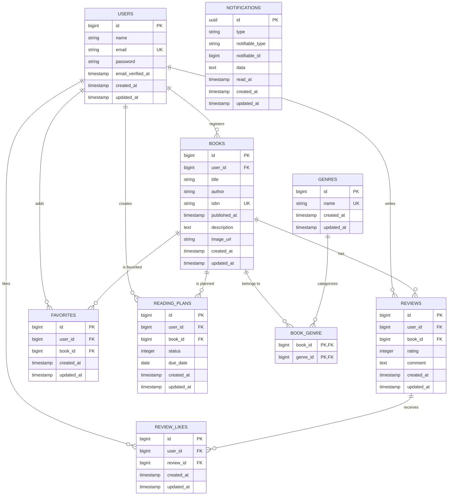

# BookShelfPJ

書籍の登録・管理・レビュー投稿ができる書籍管理アプリケーションです。
ユーザーは書籍情報を登録し、ジャンルごとに分類したり、他のユーザーのレビューを確認したりできます。
また、お気に入り機能やランキング機能、読書計画機能、読書レポート機能を通じて、日々の読書活動を管理できます。

## 使用技術

- PHP 8.5
- Laravel 10.50.3
- MySQL
- Laravel Fortify
- Laravel Sanctum
- Docker / Laravel Sail
- Blade / Vite
- Google Books API
- PHPUnit
- Laravel Pint

## 主な機能

### ユーザー認証

- ユーザー登録
- ログイン・ログアウト
- Laravel Fortifyによる認証機能

### 書籍管理

- 書籍一覧表示
- 書籍詳細表示
- 書籍登録・編集・削除
- タイトル・著者名による検索
- ジャンルによる絞り込み
- 書籍の並び替え
- ISBNによる書籍検索

### レビュー機能

- 書籍へのレビュー投稿
- レビュー編集・削除
- 評価の登録（1～5段階）
- レビューへのいいね

### お気に入り機能

- 書籍のお気に入り登録
- お気に入り解除
- お気に入り書籍の確認

### ランキング機能

- レビュー評価に基づく書籍ランキング
- 評価上位10冊の表示

### ジャンル管理

- ジャンル一覧表示
- ジャンルによる書籍分類
- ジャンル削除

### 読書計画機能

- 読書計画の登録
- 読書計画一覧表示
- 読書ステータスの管理（未読・読書中・読了）
- 読書期限の設定・変更
- 読了処理
- 読書計画の削除
- 期限に応じたリマインダー通知

### 読書レポート機能

- 読書状況の集計
- 読書実績の確認

### 外部API連携

- Google Books APIとの連携
- ISBNを利用した書籍情報の検索

## 環境構築

本プロジェクトは **Laravel Sail**（Docker）で構築します。ローカルに PHP / Composer が無くても構築できます。

### 1. リポジトリのクローン

```bash
git clone git@github.com:ryuichi-ando/bookshelf-app.git
cd bookshelf-app
```

### 2. 環境変数ファイルの作成

```bash
cp .env.example .env
```

### 3. Composer 依存のインストール（Docker 経由）

```bash
docker run --rm \
    -u "$(id -u):$(id -g)" \
    -v "$(pwd):/var/www/html" \
    -w /var/www/html \
    laravelsail/php82-composer:latest \
    composer install
```

### 4. Sail の起動

```bash
./vendor/bin/sail up -d
```

> 毎回 `./vendor/bin/sail` と打つ代わりに、エイリアスの設定を推奨します。
>
> ```bash
> alias sail='[ -f sail ] && bash sail || bash vendor/bin/sail'
> ```

### 5. アプリケーションキーの生成

```bash
sail artisan key:generate
```

### 6. マイグレーション & シーディング

```bash
sail artisan migrate --seed
```

### 7. フロントエンドアセットのビルド

```bash
sail npm install
sail npm run build   # 開発中にホットリロードする場合は sail npm run dev
```

### 8. Google Books APIの設定

Google Books APIを利用する場合は、APIキーを取得し、.envに設定してください。

```bash
GOOGLE_BOOKS_API_KEY=取得したAPIキー
```

### 9. アクセス

- アプリ：http://localhost

## テスト

PHPUnitを使用して、以下のテストを実装しています。

- Modelテスト
- Policyテスト
- Featureテスト
- ユーザー認証テスト
- 書籍管理機能テスト
- レビュー機能テスト
- お気に入り機能テスト
- 読書計画機能テスト
- APIテスト

### テスト実行

```bash
./vendor/bin/sail artisan test
```

### カバレッジ確認

```bash
./vendor/bin/sail artisan test --coverage
```

## テーブル仕様

### users テーブル

| カラム名          | 型           | primary key | unique key | not null | foreign key |
| ----------------- | ------------ | ----------- | ---------- | -------- | ----------- |
| id                | bigint       | ◯           |            | ◯        |             |
| name              | varchar(255) |             |            | ◯        |             |
| email             | varchar(255) |             | ◯          | ◯        |             |
| email_verified_at | timestamp    |             |            |          |             |
| password          | varchar(255) |             |            | ◯        |             |
| remember_token    | varchar(100) |             |            |          |             |
| created_at        | timestamp    |             |            |          |             |
| updated_at        | timestamp    |             |            |          |             |

### books テーブル

| カラム名     | 型           | primary key | unique key | not null | foreign key |
| ------------ | ------------ | ----------- | ---------- | -------- | ----------- |
| id           | bigint       | ◯           |            | ◯        |             |
| user_id      | bigint       |             |            | ◯        | users(id)   |
| title        | varcher(255) |             |            | ◯        |             |
| auther       | varcher(255) |             |            | ◯        |             |
| isbn         | varcher(13)  |             | ◯          | ◯        |             |
| published_at | date         |             |            | ◯        |             |
| description  | text         |             |            |          |             |
| image_url    | varcher      |             |            |          |             |
| created_at   | timestamp    |             |            |          |             |
| updated_at   | timestamp    |             |            |          |             |

### genre テーブル

| カラム名   | 型          | primary key | unique key | not null | foreign key |
| ---------- | ----------- | ----------- | ---------- | -------- | ----------- |
| id         | bigint      | ◯           |            | ◯        |             |
| name       | varcher(50) |             | ◯          | ◯        |             |
| created_at | timestamp   |             |            |          |             |
| updated_at | timestamp   |             |            |          |             |

### book_genre テーブル

| カラム名   | 型        | primary key | unique key | not null | foreign key |
| ---------- | --------- | ----------- | ---------- | -------- | ----------- |
| id         | bigint    | ◯           |            | ◯        |             |
| book_id    | bigint    |             |            | ◯        | books(id)   |
| genre_id   | bigint    |             |            |          | genres(id)  |
| created_at | timestamp |             |            |          |             |
| updated_at | timestamp |             |            |          |             |

### reviews テーブル

| カラム名   | 型        | primary key | unique key | not null | foreign key |
| ---------- | --------- | ----------- | ---------- | -------- | ----------- |
| id         | bigint    | ◯           |            | ◯        |             |
| user_id    | bigint    |             |            | ◯        | users(id)   |
| book_id    | bigint    |             |            | ◯        | books(id)   |
| rating     | tinyint   |             |            | ◯        |             |
| comment    | text      |             |            |          |             |
| created_at | timestamp |             |            |          |             |
| updated_at | timestamp |             |            |          |             |

### favorites テーブル

| カラム名   | 型        | primary key | unique key | not null | foreign key |
| ---------- | --------- | ----------- | ---------- | -------- | ----------- |
| id         | bigint    | ◯           |            | ◯        |             |
| user_id    | bigint    |             |            | ◯        | users(id)   |
| book_id    | bigint    |             |            | ◯        | books(id)   |
| created_at | timestamp |             |            |          |             |
| updated_at | timestamp |             |            |          |             |

### review_likes テーブル

| カラム名   | 型        | primary key | unique key | not null | foreign key |
| ---------- | --------- | ----------- | ---------- | -------- | ----------- |
| id         | bigint    | ◯           |            | ◯        |             |
| user_id    | bigint    |             |            | ◯        | users(id)   |
| review_id  | bigint    |             |            |          | reviews(id) |
| created_at | timestamp |             |            |          |             |
| updated_at | timestamp |             |            |          |             |

### reading_plans テーブル

| カラム名     | 型        | primary key | unique key | not null | foreign key |
| ------------ | --------- | ----------- | ---------- | -------- | ----------- |
| id           | bigint    | ◯           |            | ◯        |             |
| user_id      | bigint    |             |            | ◯        | users(id)   |
| book_id      | bigint    |             |            | ◯        | books(id)   |
| due_date     | date      |             |            | ◯        |             |
| status       | tinyint   |             |            | ◯        |             |
| completed_at | timestamp |             |            | ◯        |             |
| created_at   | timestamp |             |            |          |             |
| updated_at   | timestamp |             |            |          |             |

### notifications テーブル

| カラム名      | 型        | primary key | unique key | not null | foreign key |
| ------------- | --------- | ----------- | ---------- | -------- | ----------- |
| id            | bigint    | ◯           |            | ◯        |             |
| type          | string    |             |            | ◯        |             |
| notifiable_id | bigint    |             |            | ◯        | users(id)   |
| data          | text      |             |            | ◯        |             |
| read_at       | timestamp |             |            |          |             |
| created_at    | timestamp |             |            |          |             |
| updated_at    | timestamp |             |            |          |             |

## ER図



## API エンドポイント一覧

| HTTPメソッド | URI                | 説明         | 認証・認可   |
| ------------ | ------------------ | ------------ | ------------ |
| GET          | /api/v1/books      | 書籍一覧取得 | 不要         |
| GET          | /api/v1/books/{id} | 書籍詳細取得 | 不要         |
| POST         | /api/v1/books      | 書籍登録     | Sanctum 必須 |
| PUT          | /api/v1/books/{id} | 書籍更新     | Sanctum 必須 |
| DELETE       | /api/v1/books/{id} | 書籍削除     | Sanctum 必須 |

## ログイン情報

ユーザー  
　 id：yamada@example.com／suzuki@example.com  
　 pass：password

## URL

・開発環境：http://localhost/  
・phpMyAdmin：http://localhost:8080/
